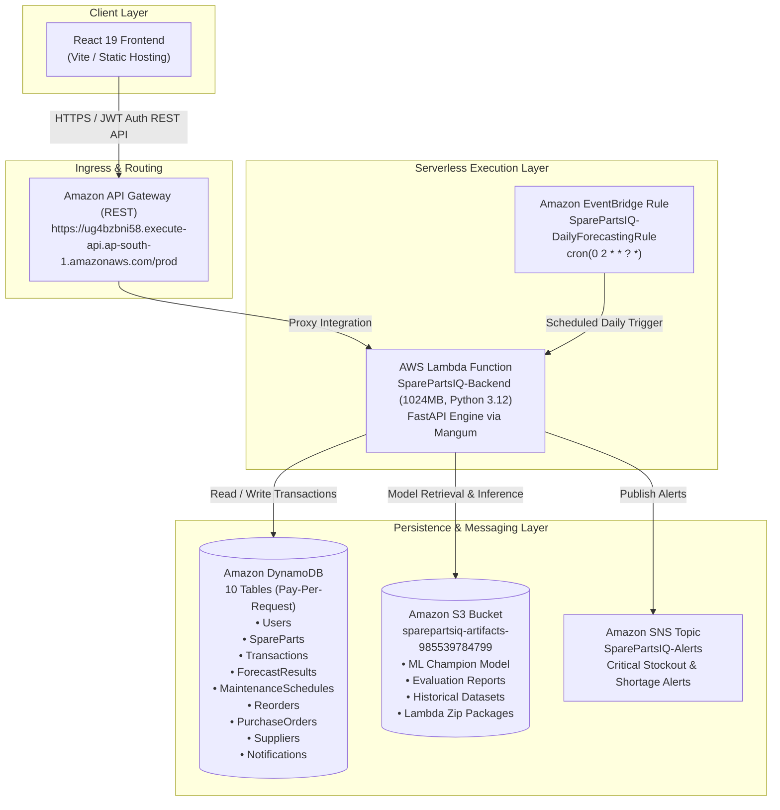

# SparePartsIQ ⚙️🧠

### AI-Powered Industrial Spare Parts Inventory Intelligence & Predictive Maintenance System

[](https://www.python.org/)
[](https://fastapi.tiangolo.com)
[](https://react.dev/)
[](https://aws.amazon.com/)
[](LICENSE)
[]()

SparePartsIQ is an enterprise-grade, machine-learning-driven industrial spare parts inventory optimization and predictive maintenance platform. Built for continuous manufacturing facilities, heavy industrial plants, and reliability engineering teams, it eliminates unplanned machine downtime by transitioning inventory replenishment from reactive emergency ordering to predictive demand forecasting.

---

## 📑 Table of Contents

- [Problem Statement](#-problem-statement)
- [System Objectives](#-system-objectives)
- [Key Features](#-key-features)
- [Technology Stack](#-technology-stack)
- [AWS Cloud Architecture](#-aws-cloud-architecture)
- [Machine Learning Implementation](#-machine-learning-implementation)
- [Installation & Setup](#-installation--setup)
- [Local Execution Instructions](#-local-execution-instructions)
- [REST API Reference](#-rest-api-reference)
- [Screenshots & UI Walkthrough](#-screenshots--ui-walkthrough)
- [Security & Hardening](#-security--hardening)
- [Deployment Package & S3 Storage](#-deployment-package--s3-storage)
- [Future Enhancements](#-future-enhancements)
- [Documentation Index](#-documentation-index)

---

## 🚨 Problem Statement

Modern manufacturing facilities face a persistent inventory paradox:
1. **Costly Unplanned Downtime:** Critical production equipment breakdowns frequently stall entire assembly lines because replacement bearings, valves, or hydraulic seals are out of stock. Unplanned factory downtime can exceed **$20,000 to $100,000 per hour**.
2. **Excess Working Capital:** In response to stockouts, plant managers over-order slow-moving components, tying up millions of dollars in dead warehouse inventory.
3. **Decoupled Maintenance & Purchasing:** Preventive maintenance schedules exist in maintenance software while purchasing operates inside separate ERP systems, leaving work orders blindsided by missing components with 4–8 week supplier lead times.
4. **Failure of Rule-of-Thumb Heuristics:** Static Min/Max levels fail to account for operational seasonality, machine aging, utilization spikes, and supplier supply chain variability.

---

## 🎯 System Objectives

SparePartsIQ bridges the gap between predictive maintenance and supply chain procurement:

1. **Intelligent Spare Parts Catalog:** Real-time visibility into stock levels, unit valuations, locations, and lead times across all critical components.
2. **Predictive ML Demand Forecasting:** Dynamic, multi-horizon (7-day, 30-day, and 90-day) autoregressive consumption forecasting using verified machine learning models.
3. **Stockout Risk Identification:** Continuous scoring of stockout probabilities based on supplier lead times, predicted burn rates, and current buffer stock.
4. **Automated Reorder Optimization:** Dynamic safety stock calculation ($SS = Z \times \sqrt{L} \times \sigma_d$) and automated reorder recommendation generation.
5. **Maintenance-Driven Inventory Allocation:** Cross-referencing preventive maintenance work orders with on-hand spare parts to detect shortages weeks before scheduled overhaul dates.
6. **Procurement & Purchase Order Management:** Complete purchase order lifecycle with role-based approval workflows for Purchase Managers.
7. **Supplier Performance Monitoring:** Tracking vendor reliability, lead time compliance, and unit pricing.
8. **Executive Analytics Dashboard:** High-level visibility into total inventory valuation, category asset distribution, monthly expenditure trends, and urgent components.
9. **Multi-Channel Operational Alerts:** Cloud-native notification routing via Amazon SNS for critical stockout risks and maintenance warnings.
10. **Zero-Cost Cloud Scalability:** Designed to operate seamlessly on AWS Serverless infrastructure within the ₹0 AWS Free Tier budget.

---

## ✨ Key Features

```
┌─────────────────────────────────────────────────────────────────────────────┐
│                             SparePartsIQ Core                               │
├─────────────────────┬─────────────────────┬─────────────────────────────────┤
│ 📦 Inventory Intel  │ 🤖 AI Forecasting   │ 🛠️ Maintenance Planning         │
│ • Live Stock CRUD   │ • 7/30/90 Day Waves │ • 8 Monitored Production Assets │
│ • Category & ROP    │ • Random Forest Reg │ • Work Order Spare Allocation   │
│ • Stock In/Out Log  │ • S3 Model Serving  │ • Shortage Deficit Alerts       │
├─────────────────────┼─────────────────────┼─────────────────────────────────┤
│ 🛒 Procurement Flow │ 📊 Analytics & KPIs │ 🔔 Operational Alerting         │
│ • Reorder Proposals │ • $5.9M+ Valuation  │ • Amazon SNS Integration        │
│ • Dynamic SS & EOQ  │ • Spend Burn Trends │ • Critical Severity Categorizer │
│ • PO Lifecycle Mgmt │ • Category Shares   │ • Role-Based Inboxes            │
└─────────────────────┴─────────────────────┴─────────────────────────────────┘
```

- **Multi-Role Access Control (RBAC):** Distinct functional scopes for **Inventory Managers**, **Maintenance Teams**, and **Purchase Managers**, authenticated via 256-bit cryptographically signed JSON Web Tokens (JWT).
- **Dual-Storage Engine:** Zero-configuration local development via SQLite with transparent fallback to enterprise AWS DynamoDB on-demand tables.
- **Automated EventBridge Scheduling:** Daily 02:00 UTC autonomous batch inference jobs generating forecasts across the entire inventory catalog.

---

## 🛠️ Technology Stack

| Domain | Technology / Library | Purpose |
|---|---|---|
| **Frontend** | React 19, Vite, Tailwind CSS, Lucide Icons | Responsive, high-performance industrial management portal |
| **Data Visualization** | Chart.js, React-Chartjs-2 | Interactive burn trends, category distribution, horizon graphs |
| **Backend API** | Python 3.10 / 3.12, FastAPI, Pydantic, Uvicorn | High-throughput asynchronous REST API |
| **Cloud Packaging** | Mangum (ASGI Adapter) | Serverless bridge connecting FastAPI directly to AWS Lambda |
| **Machine Learning** | Scikit-Learn, SciPy, NumPy, Joblib, Pandas | Feature engineering, cross-validation, Random Forest Regressor |
| **Cloud Compute** | AWS Lambda (1024 MB, Python 3.12, x86_64) | On-demand serverless execution |
| **Cloud API Layer** | Amazon API Gateway (REST API) | Public regional API gateway with proxy integration |
| **Cloud Storage** | Amazon DynamoDB (10 on-demand tables) | Low-latency NoSQL data persistence (Pay-Per-Request) |
| **Artifact Storage** | Amazon S3 (AES-256 encrypted) | Model artifacts, baseline datasets, and Lambda zip storage |
| **Event Scheduling** | Amazon EventBridge | Cron-scheduled autonomous daily batch forecasting jobs |
| **Alert Notification**| Amazon SNS | Cloud publish/subscribe notifications for critical events |
| **Security & Auth** | Passlib, Bcrypt, PyJWT, Cryptography | Password hashing, JWT token generation, role verification |

---

## ☁️ AWS Cloud Architecture

SparePartsIQ is built on a 100% serverless, event-driven cloud architecture in region `ap-south-1` (Mumbai):



### Free Tier Cost Optimization
- **Zero Provisioned Capacity:** All DynamoDB tables use `PAY_PER_REQUEST` billing mode, avoiding provisioned capacity charges.
- **Zero Cache Charges:** API Gateway cache clusters are disabled (`cacheClusterEnabled: false`).
- **Free Monthly Invocations:** AWS Lambda includes 1,000,000 requests and 400,000 GB-seconds free per month.
- **Storage Protection:** Database and S3 storage consume less than 1% of permanent free tier allowances.
- **Estimated Operating Cost:** **$0.00 / month** under AWS Free Tier; **~$0.04 / month** post Free Tier.

---

## 🧠 Machine Learning Implementation

### 1. Data Pipeline & Feature Engineering
Trained on 365 days of industrial equipment telemetry and consumption logs across 64 components:
- **Lag Features:** `lag_1`, `lag_2`, `lag_7`, `lag_14` (capturing short-term and weekly inertia).
- **Rolling Windows:** `rolling_mean_7`, `rolling_std_7`, `rolling_mean_14`, `rolling_mean_30` (volatility and moving trend indicators).
- **Plant Context:** `machine_utilization_pct`, `is_maintenance_day` (equipment duty cycle factors).
- **Temporal Indicators:** `day_of_week`, `month` (cyclical operational patterns).

### 2. Model Evaluation & Benchmark Results
Evaluated using chronological train-validation-test splitting (70% Train, 15% Validation, 15% Out-of-sample Test):

| Model Candidate | Val MAE | Val RMSE | Test MAE | Test RMSE | Test MAPE | Selection |
|---|:---:|:---:|:---:|:---:|:---:|:---:|
| **Simple Moving Average (7D)** | 0.5340 | 0.8209 | 0.5558 | 0.8583 | 75.54% | Baseline |
| **Exponential Smoothing ($\alpha=0.3$)** | 0.6771 | 0.8383 | 0.6815 | 0.8606 | 46.25% | Baseline |
| **Gradient Boosting Regressor** | 0.5052 | 0.6724 | 0.4777 | 0.6165 | 59.30% | Candidate |
| **Random Forest Regressor** | **0.4908** | **0.6451** | **0.4802** | **0.6155** | **59.13%** | **🏆 Champion Model** |

### 3. Serverless ML Inference Architecture
The trained champion model (`champion_forecast_model.joblib`) is stored in Amazon S3 and loaded into `/tmp/` on cold starts. It is cached in-memory inside the AWS Lambda execution environment, allowing warm inference requests to return multi-horizon forecasts in under **140 milliseconds**.

---

## 💻 Installation & Setup

### Prerequisites
- **Python:** Version 3.10 or 3.12
- **Node.js:** Version 18 or higher (with npm)
- **Git**

### 1. Clone the Repository
```bash
git clone https://github.com/your-username/SparePartsIQ.git
cd SparePartsIQ
```

### 2. Configure Backend Environment
Create a `.env` file in the project root based on the provided template:
```bash
# Windows PowerShell:
Copy-Item .env.example .env

# Linux / macOS:
cp .env.example .env
```
Generate and configure a secure 256-bit JWT secret:
```bash
python -c "import secrets; print('JWT_SECRET=' + secrets.token_hex(32))"
```
Paste the generated key into your `.env` file under `JWT_SECRET`.

### 3. Configure Frontend Environment
Create a `.env` file inside the `frontend/` directory:
```bash
# Windows PowerShell:
Copy-Item frontend/.env.example frontend/.env

# Linux / macOS:
cp frontend/.env.example frontend/.env
```

### 4. Install Dependencies
```bash
# Backend dependencies
pip install -r backend/requirements.txt   # or install fastapi uvicorn boto3 scikit-learn pydantic pyjwt passlib bcrypt python-dotenv

# Frontend dependencies
cd frontend
npm install
cd ..
```

### 5. Initialize Database (Local SQLite or AWS DynamoDB)
For local development, populate the SQLite database with 64 spare parts, 8 machines, 10 suppliers, and sample records:
```bash
python scripts/seed_sqlite.py
```
*(To seed your AWS DynamoDB tables instead, set `STORAGE_MODE=aws` in `.env` and run `python scripts/seed_dynamodb.py`)*

---

## 🚀 Local Execution Instructions

### 1. Start the FastAPI Backend
```bash
python -m uvicorn backend.main:app --host 127.0.0.1 --port 8000 --reload
```
- API Base URL: `http://localhost:8000`
- Interactive Swagger Documentation: `http://localhost:8000/docs`
- Healthcheck Endpoint: `http://localhost:8000/api/health`

### 2. Start the React Frontend Dashboard
In a separate terminal window:
```bash
cd frontend
npm run dev -- --host 127.0.0.1 --port 3000
```
- Open your browser at: `http://localhost:3000`

### 3. Run Automated Tests
```bash
python -m pytest tests/test_backend.py -v
```
*Executes all 13 end-to-end integration tests validating authentication, inventory CRUD, ML forecasting, and stockout assessment.*

---

## 📡 REST API Reference

The backend provides a comprehensive, documented REST API with OpenAPI/Swagger interactive exploration at `/docs`.

| Method | Endpoint | Auth | Description |
|---|---|:---:|---|
| `GET` | `/api/health` | None | Service status, runtime mode, and AWS region |
| `POST` | `/api/auth/login` | None | Authenticate user and issue 24-hour signed JWT |
| `GET` | `/api/inventory` | Bearer | Retrieve catalog parts (supports search, category, low-stock filter) |
| `POST` | `/api/inventory` | Bearer | Create a new industrial spare part record |
| `POST` | `/api/inventory/transaction` | Bearer | Record stock movement (Stock IN / Consumption OUT) |
| `GET` | `/api/forecasts` | Bearer | Retrieve cached 7, 30, and 90-day forecast curves |
| `POST` | `/api/forecasts/generate` | Bearer | Trigger on-demand ML inference for a specific component |
| `GET` | `/api/forecasts/evaluation/metrics` | Bearer | Retrieve champion model validation and test performance metrics |
| `GET` | `/api/maintenance/schedules` | Bearer | List equipment overhaul schedules and work orders |
| `GET` | `/api/maintenance/at-risk` | Bearer | Identify maintenance activities facing component shortage risks |
| `GET` | `/api/stockout-risk` | Bearer | List real-time stockout probability assessments |
| `GET` | `/api/reorders/recommendations` | Bearer | List automated replenishment proposals |
| `POST` | `/api/reorders/decision` | Bearer | Approve or reject a reorder recommendation (Purchase Manager) |
| `GET` | `/api/analytics/dashboard` | Bearer | Aggregated KPIs, valuation, category shares, and urgent parts |
| `POST` | `/api/notifications/alert` | Bearer | Publish critical notification to database and Amazon SNS topic |

---

## 📸 Screenshots & UI Walkthrough

### 1. Executive Analytics Dashboard
Comprehensive operations hub showcasing real-time inventory valuation ($5.92M), total parts tracked (64), active stockout alerts, category asset allocation bar charts, and monthly expenditure trends.

### 2. AI Demand Forecasting Console
Interactive forecast generator allowing reliability engineers to inspect 7, 30, and 90-day projected consumption waves, compare against historical actuals, and review cross-validation metrics.

### 3. Maintenance Shortage & Equipment Work Orders
Equipment directory spanning 8 manufacturing assets (CNC Machining Centers, Injection Molders, Robotic Welding Cells) cross-referencing spare parts availability to prevent downtime during scheduled overhauls.

### 4. Automated Reorder & Procurement Pipeline
Automated suggestion table computing Dynamic Safety Stock and Economic Order Quantities with a 1-click approval workflow for Purchase Managers.

---

## 🔒 Security & Hardening

SparePartsIQ has undergone a comprehensive multi-tier security audit ([`SPAREPARTSIQ_SECURITY_AUDIT.md`](SPAREPARTSIQ_SECURITY_AUDIT.md)):
- **Zero Client-Side Passwords (SEC-01):** Hardcoded demo password maps and automatic frontend login have been completely eliminated. All authentication requests are processed via hashed passwords against backend storage.
- **Mandatory 256-bit JWT Secrets (SEC-02):** Insecure static fallback keys have been replaced with strict environment variable enforcement (`JWT_SECRET`).Startup fails immediately with a `RuntimeError` if the secret is missing.
- **Scoped CORS Whitelist (SEC-03):** Wildcard origins (`*`) with credentials enabled have been replaced with an explicit domain whitelist (`http://localhost:3000`, `http://127.0.0.1:3000`), blocking unauthorized cross-origin requests.
- **Repository Hygiene:** All `.env` files, temporary artifacts, deployment zip archives, and test credentials are excluded via an airtight `.gitignore`.

---

## 📦 Deployment Package & S3 Storage

To keep this Git repository lightweight and avoid storing large compiled binary wheels in source control:
- The full 65.51 MB serverless Lambda deployment bundle (containing compiled Python 3.12 manylinux wheels for `scikit-learn`, `scipy`, and `numpy`) is hosted in Amazon S3:
  ```
  s3://sparepartsiq-artifacts-985539784799/lambda/backend_lambda.zip
  ```
- **Downloading the pre-packaged bundle:**
  ```bash
  aws s3 cp s3://sparepartsiq-artifacts-985539784799/lambda/backend_lambda.zip build/backend_lambda.zip
  ```
- **Building a fresh deployment package:**
  Use the included packaging utility in `infrastructure/package_lambda.py` to compile dependencies and create a fresh zip package.

---

## 🔮 Future Enhancements

- **Deep Learning Time-Series Forecasters:** Benchmarking foundational time-series models (PatchTST, Chronos, and DeepAR) against the Random Forest champion.
- **IoT Vibration & Telemetry Streaming:** Real-time ingestion of machine vibration, temperature, and motor current via AWS IoT Core to trigger condition-based spare parts reservations.
- **Multi-Plant / Multi-Warehouse Routing:** Multi-facility inventory visibility enabling automated inter-plant transfer requests before issuing new purchase orders.
- **Automated Supplier EDI / ERP Connectors:** Direct integration with SAP S/4HANA and Oracle NetSuite for automated purchase requisition release.

---

## 📚 Documentation Index

For in-depth architectural and operational guides, refer to the following project documents:
- [AWS Cloud Architecture Specification](AWS_ARCHITECTURE.md)
- [AWS Serverless Deployment Guide](AWS_DEPLOYMENT_GUIDE.md)
- [Final AWS Cost & Resource Audit](SPAREPARTSIQ_FINAL_AWS_COST_AUDIT.md)
- [Machine Learning Implementation Report](ML_IMPLEMENTATION_REPORT.md)
- [Comprehensive Security Audit & Remediation](SPAREPARTSIQ_SECURITY_AUDIT.md)
- [API Documentation & Schema](API_DOCUMENTATION.md)
- [Live Demonstration Walkthrough](PROJECT_DEMONSTRATION_GUIDE.md)
- [Automated Integration Test Results](TEST_RESULTS.md)

---

## 📄 License

This project is licensed under the MIT License — see the [LICENSE](LICENSE) file for details.
