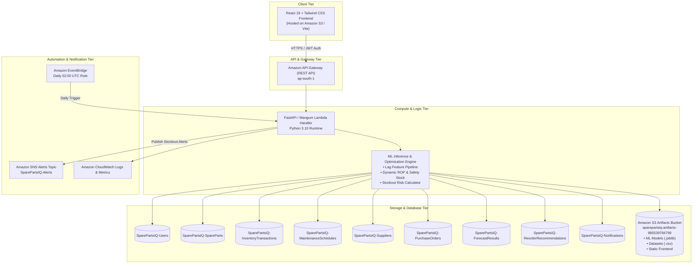

# SparePartsIQ Technical Architecture

## 1. Executive Summary
**SparePartsIQ** is an autonomous industrial spare parts intelligence and inventory optimization platform engineered for manufacturing enterprises, factories, and utility facilities. It converts traditional reactive inventory control into predictive and intelligent inventory management.

---

## 2. Serverless Cloud Architecture Diagram

---

## 3. Core Architectural Modules

### 3.1 Authentication & Role-Based Access Control (RBAC)
- **Token Format:** Industry-standard signed JWT (HMAC-SHA256) with 24-hour expiration.
- **Password Protection:** Cryptographic salted hashing via `bcrypt`.
- **Supported Roles:**
  1. `Inventory Manager`: Full spare part CRUD, inventory movement check-in/check-out, low/overstock analysis, model retraining trigger.
  2. `Maintenance Team`: Machine directory access, maintenance work order creation, required parts checking against live inventory, shortage identification.
  3. `Purchase Manager`: Reorder recommendation review, approval/rejection decision engine, automated purchase order generation, supplier performance evaluation.

### 3.2 Inventory Intelligence & Movements
- Complete 15-attribute schema tracking: Part ID, Part Name, Category, Description, Manufacturer, Supplier ID, Unit Cost, Supplier Lead Time, Machine Compatibility, Criticality Level, Warehouse Location, Min Stock, Max Stock, Reorder Point, and Current Stock.
- Immutable ledger tracking of transactions (`SparePartsIQ-InventoryTransactions`) for every check-in (`IN`), consumption (`OUT`), and reconciliation (`ADJUSTMENT`).

### 3.3 AI Demand Forecasting
- **Feature Pipeline:** 12 engineered features including lag periods ($t-1, t-2, t-7, t-14$), rolling statistics (7, 14, 30 days mean & std), machine utilization rates, calendar indicators, and scheduled maintenance impact flags.
- **Chronological Time Splitting:** 70% Train, 15% Validation, 15% Test chronologically separated to guarantee zero lookahead leakage.
- **Champion Model:** `Random_Forest_Regressor` (Validation RMSE: `0.6451`, outperforming Moving Average and Exponential Smoothing).
- **Forecast Horizons:** 7-day, 30-day, and 90-day predictive run-rates.

### 3.4 Stockout Risk Assessment
- Validated mathematical scoring based on effective available inventory:
  $$\text{Effective Stock} = \text{Current Stock} + \text{Incoming PO} - \text{Lead Time Maintenance Requirements}$$
- Classification tiers:
  - **Critical:** Coverage strictly below supplier lead time or effective stock $\le 0$.
  - **High:** Coverage $< 1.5\times$ lead time or current stock below ROP.
  - **Medium:** Buffer adequate for normal variance but sensitive to supply disruptions.
  - **Low:** Healthy inventory runway.

### 3.5 Intelligent Reorder Optimization
- **Dynamic Safety Stock ($SS$):**
  $$SS = Z \times \sqrt{L} \times \sigma_d$$
  Where $Z = 1.65$ (95% service level), $L$ is supplier lead time, and $\sigma_d$ is daily demand standard deviation.
- **Dynamic Reorder Point ($ROP$):**
  $$ROP = (d \times L) + SS + D_{\text{maintenance}}$$
- **Order Quantity Recommendation:** Economic replenishment targeting maximum storage capacity plus planned maintenance buffer.
- **Automated Workflow:** Approval by Purchase Manager triggers immediate creation of a tracked Purchase Order.

